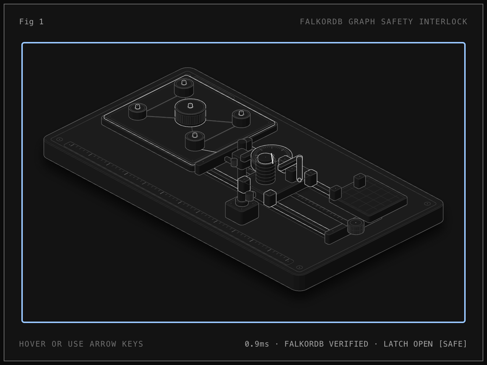
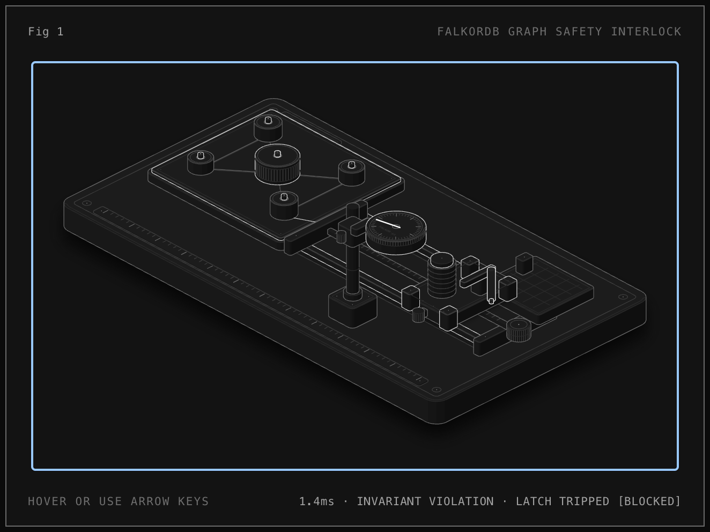

# Guard: Graph-Powered Safety Layer for AI Coding Agents

> **A high-velocity, graph-native regression prevention engine built on FalkorDB.**  
> Guard selects the exact minimal subset of tests to run after an AI coding agent modifies code, measures a multi-factor **Trust Score**, and deterministically triggers hard fallbacks to full test suites when graph confidence drops.

## 1. Problem Statement & Motivation

When AI coding agents (Claude Code, Cursor, Codex, OpenCode) modify complex codebases, running the entire test suite on every step slows iteration cycles to a crawl. Conversely, naive heuristics used by developers or agents to speed things up introduce catastrophic silent escapes:

- **Same-File Heuristic (`same-file`)**: Only runs tests in the matching test file (e.g., changes in `src/flask/helpers.py` $\to$ run `tests/test_helpers.py`). In real production architectures, foundational helpers, middleware, and lifecycle hooks are heavily exercised across disparate modules (`test_basic.py`, `test_blueprints.py`, `test_templating.py`). On the held-out benchmark, **`same-file` suffered a 17.6% Escape Rate** (3 missed failures).
- **Agent Guessing (`naive-guess`)**: LLMs predicting test paths based on file names or semantic similarity produce identical blind spots and hallucinate coverage.
- **Run-All Suite (`run-all`)**: 100% safe, but destroys developer velocity and agent autonomy on non-trivial suites.

**Guard's Core Thesis**: Code relationships and test executions form a graph topology. By indexing static AST relationships and per-test dynamic coverage contexts inside **FalkorDB**, Guard computes exact dependency subgraphs, measures empirical test confidence, dynamically widens around ambiguous dynamic dispatch, and enforces hard overrides when evidence is absent.

---

## 2. Verified Benchmark Results (Held-Out Evaluation)

Guard was evaluated against **`pallets/flask`** (494 tests) across 24 held-out mutants under a frozen protocol (`evals/split.json`, `PLAN.md`). 

All metrics are evaluated and reported as **Paired Metrics** (Escape Rate $\leftrightarrow$ Fallback Rate $\leftrightarrow$ Savings Ratio):

| Strategy / Engine | Escape Rate (Paired) | Savings Ratio (Paired) | Fallback Rate (Paired) | Killable Evaluated | Escapes |
| :--- | :---: | :---: | :---: | :---: | :---: |
| **`run-all`** (Ground Truth) | 0.0% (0/17) | 0.0% | 100.0% (24/24) | 17 | None |
| **`same-file`** (Heuristic) | 17.6% (3/17) | 77.3% | 0.0% (0/24) | 17 | `m08`, `m16`, `m30` |
| **`naive-guess`** (Agent Guess) | 17.6% (3/17) | 77.5% | 0.0% (0/24) | 17 | `m08`, `m16`, `m30` |
| **`guard` (Full System)** | **0.0% (0/17)** | **67.3%** | **25.0% (6/24)** | 17 | **0 (Zero)** |
| *Ablation 1: `guard-no-confidence`* | 0.0% (0/17) | 77.1% | 20.8% (5/24) | 17 | None |
| *Ablation 2: `guard-no-widening`* | 0.0% (0/17) | 73.3% | 25.0% (6/24) | 17 | None |

> **Key Result**: Guard achieved a **0.0% Escape Rate** while delivering **67.3% Test-Time Savings** compared to `run-all`, completely eliminating the 17.6% escape rate of `same-file`.

### Case Study: Root Cause of `m08` Escape Under `same-file`
- **Mutant `m08`** inverted an `if not` statement in `src/flask/helpers.py:45`.
- `same-file` and `naive-guess` selected `tests/test_helpers.py` (30 tests) $\to$ **0 failures reported (Escape)**.
- `guard` traversed FalkorDB `COVERED_BY` edges and detected dependent execution paths in `tests/test_basic.py`, `tests/test_blueprints.py`, and `tests/test_templating.py` (26 tests) $\to$ **Caught failure immediately (0.0% escape)**.

---

## 3. Architecture & System Design

```
                     +-----------------------------+
                     |    Agent Git Diff / HEAD    |
                     +--------------+--------------+
                                    |
                                    v
                     +-----------------------------+
                     |   AST Diff Analyzer (T5a)   |
                     |  - Maps diff lines to funcs |
                     |  - Checks touched files     |
                     +--------------+--------------+
                                    |
                                    v
+------------------+         +--------------+         +------------------+
| Dynamic Coverage |         |   FalkorDB   |         | Static AST Parse |
|  pytest-cov ctx  +-------->| Graph Engine |<--------+  ast / symtable  |
+------------------+         +-------+------+         +------------------+
                                     |
                                     v
                     +-----------------------------+
                     |    Decision Engine (T5)     |
                     |  - Hard Overrides Gate      |
                     |  - Trust Score Calculation  |
                     |  - 3-Level Policy Routing   |
                     +--------------+--------------+
                                    |
                   +----------------+----------------+
                   |                                 |
                   v                                 v
         [High Trust: >= 0.8]              [Low Trust / Fallback]
         Run Selected Subset                  Run Full Suite
                   |                                 |
                   +----------------+----------------+
                                    |
                                    v
                     +-----------------------------+
                     |    Feedback Loop (T6)       |
                     |  - Miss Repair Edges        |
                     |  - Self-Healing Confidence  |
                     +-----------------------------+
```

### 3.1. FalkorDB Graph Schema

The graph layer leverages FalkorDB for low-latency Cypher queries and multi-hop graph traversals:

#### Nodes
- `(:File {path})`: Source files and test files in the repository.
- `(:Function {id, file, name, qualname, start, end, has_dynamic_dispatch, no_evidence})`: Function and method definitions.
- `(:Test {id, file, name, qualname, start, end, flake_rate})`: Pytest test units.
- `(:Run {id, timestamp, commit_sha, duration_ms, total_tests, passed, failed})`: Historical test execution runs.

#### Edges
- `(:Function)-[:DEFINED_IN]->(:File)`: Static structural hierarchy.
- `(:Test)-[:DEFINED_IN]->(:File)`: Static test placement.
- `(:Function)-[:CALLS {source: 'static', confidence: 0.6, last_verified_sha}]->(:Function)`: Multi-hop static call graph.
- `(:File)-[:IMPORTS {source: 'static', confidence: 0.6}]->(:File)`: Module import topology.
- `(:Function)-[:COVERED_BY {source: 'coverage'|'miss_repair', confidence, evidence_count, last_verified_sha}]->(:Test)`: Verified dynamic execution evidence connecting modified functions directly to covering tests.
- `(:Test)-[:FAILED_IN {source: 'test_run', error_message}]->(:Run)`: Historical test failure records.

---

## 4. Decision Engine & Trust Model

Guard evaluates code changes using a strict two-stage process: **Hard Safety Overrides** followed by the **Empirical Trust Score Policy**.

### 4.1. Hard Safety Overrides (Pre-Emptive Gating)
Before computing continuous scores, Guard enforces three non-bypassable guardrails:
1. **Test Files Touched**: If any test file is modified or added, Guard forces `run-all` with a safety warning (modifying assertions could invalidate test isolation).
2. **Missing Evidence (`no_evidence`)**: If any modified function lacks dynamic coverage evidence in FalkorDB, Guard automatically falls back to `run-all` (never guess when unmapped).
3. **Dynamic Dispatch Flagged**: If AST analysis flags dynamic dispatch (`getattr`, `setattr`, `eval`, `**kwargs` dispatch), Guard automatically triggers **Dynamic Widening**, expanding the candidate test set to include all module tests.

### 4.2. Trust Score Formula
When no hard overrides force `run-all`, Guard computes the composite trust metric:

$$\text{Trust} = 0.5 \cdot \text{EvidenceRatio} + 0.3 \cdot \text{Freshness} + 0.2 \cdot (1 - \text{UncertainRatio})$$

- $\text{EvidenceRatio}$: Mean of the highest covering-edge confidence per modified function ($0.0$ for functions without covering edges).
- $\text{Freshness}$: Proportion of evidence edges whose `last_verified_sha` matches the current commit SHA.
- $\text{UncertainRatio}$: Proportion of modified functions flagged with dynamic dispatch patterns.

### 4.3. Three-Level Execution Policy
- **$\text{Trust} \ge 0.8$ (`subset`)**: Execute only the directly covering tests mapped via high-confidence `COVERED_BY` edges.
- **$0.5 \le \text{Trust} < 0.8$ (`medium`)**: Execute the covering subset plus all tests associated with the modified modules.
- **$\text{Trust} < 0.5$ (`run-all`)**: Enforce full test suite fallback.

<p align="center">
  
  &nbsp;
  
</p>

---

## 5. Self-Healing Feedback Loop

When an unexpected regression or missed test failure occurs:
1. The failure event is captured via `guard feedback --function <func_id> --test <test_id>`.
2. Guard writes a synthetic repair edge `(:Function)-[:COVERED_BY {source: 'miss_repair', confidence: 1.0}]->(:Test)`.
3. The `no_evidence` flag on the function is cleared.
4. Future decisions for this function or its callers automatically select the repaired test, preventing recurring escapes.

---

## 6. Installation & Quickstart

### Prerequisites
- Python 3.10+
- Docker & Docker Compose (for FalkorDB)

### 1. Start FalkorDB
```bash
docker compose up -d
# FalkorDB is live on localhost:6379
# Web UI is accessible on http://localhost:3000
```

### 2. Install Guard
```bash
pip install -e .
# Or install with dev dependencies:
pip install -e ".[dev]"
```

### 3. Ingest Target Repository
```bash
# 1. Ingest static AST topology into FalkorDB
guard ingest-static /path/to/target/repo --include-tests

# 2. Ingest per-test coverage contexts (runs pytest with --cov-context=test)
guard ingest-coverage /path/to/target/repo --runs 3

# 3. View database statistics
guard stats
```

---

## 7. CLI Reference

### `guard run`
Executes agent pre-completion test verification on the current working tree diff:
```bash
guard run --repo /path/to/target/repo
```
*Exits with code 0 on success, or code 1 if tests fail or trust is breached, blocking autonomous agents from committing broken code.*

### `guard check`
Computes the test selection decision without executing tests (outputs JSON or human-readable format):
```bash
guard check --repo /path/to/target/repo --json
```

### `guard callers`
Traverses multi-hop static call graph in FalkorDB up to $N$ hops:
```bash
guard callers "src/flask/app.py::Flask.dispatch_request" --hops 4 --min-confidence 0.6
```

### `guard covering-tests`
Queries all tests covering a specific function ordered by edge confidence:
```bash
guard covering-tests "src/flask/helpers.py::url_for"
```

### `guard feedback`
Repairs the graph after a missed failure:
```bash
guard feedback --function "src/flask/helpers.py::url_for" --test "tests/test_helpers.py::test_url_for"
```

---

## 8. Architectural Trade-offs & Limits

### What Graph-Native Architecture Enables
- **Deterministic Traceability**: Every skipped test has an explicit, queryable reason (`guard check --json` outputs edge justifications for all known tests).
- **Cross-Module Awareness**: Identifies deep, non-obvious test linkages across package boundaries that escape keyword search or lexical matching.
- **Fail-Safe Convergence**: Combines static structure with empirical dynamic execution contexts so that gaps trigger defensive full runs rather than silent failures.

### Known Limits and Edge Cases
1. **Dynamic Python Metaprogramming**: Heavy dynamic dispatch (`getattr(module, var)()`, custom metaclasses, dynamic decorators) cannot be completely resolved via static AST. *Mitigation*: Guard detects dynamic syntax patterns and triggers dynamic widening or full fallbacks.
2. **Initial Ingestion Cost**: Generating fine-grained per-test coverage contexts requires an initial baseline run (`pytest --cov-context=test`), which can incur a 1.5x–2.0x slowdown during graph ingestion.
3. **Ecosystem Scope**: Currently tuned for Python repositories using `pytest`.

---

## 9. Verification & Quality Invariants

Guard development adheres to strict engineering rules (`PLAN.md` R1–R9):
- **Frozen Benchmarks**: Acceptance claims and split files are immutable and verified through independent verifier runs (`reports/verify_t*.md`).
- **Zero Flake Tolerance**: Flaky tests are detected during ingest runs and excluded from dynamic evidence edges.
- **Complete Test Coverage**: Pure decision logic, parsers, and graph writers are covered with unit and integration tests under `tests/`.
